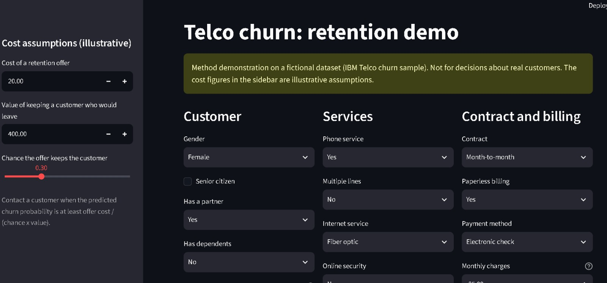
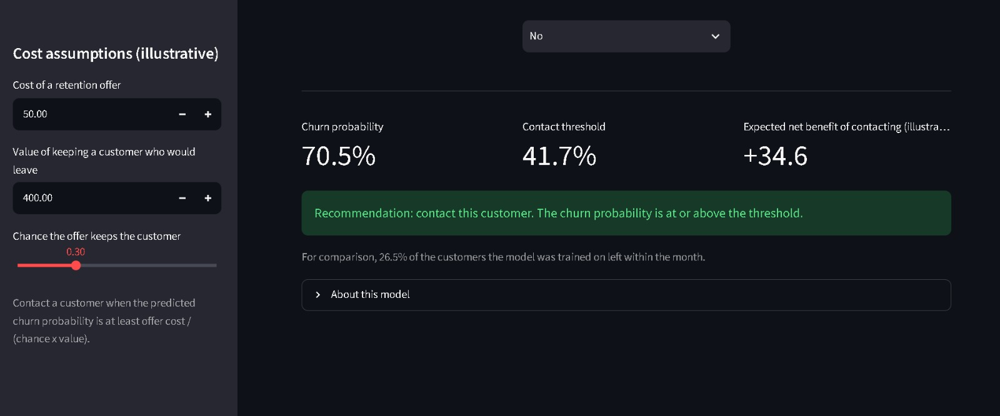
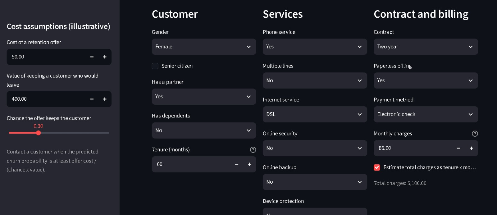
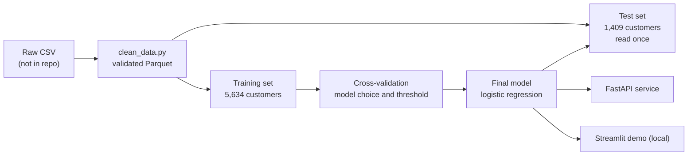

# Telco Customer Churn: prediction, cost-based decisions and a tested API

A churn model for a fictional telecom company, built end to end: cleaning with validation, cross-validated model comparison with a pre-registered selection rule, a cost-based decision threshold, a one-time held-out test evaluation, model explanations, a validated FastAPI service and a Streamlit demo.

> **This is a method demonstration.** The data is IBM's fictional Telco churn sample, so the results say nothing about real customers. Its license is unclear (see [docs/data_source.md](docs/data_source.md)), so **neither the data nor the trained model is in this repository** and there is no public hosted demo. The demo runs locally.



| Changing the cost assumptions | A different customer |
|---|---|
|  |  |

## Results

7,043 customers, 26.54% churned. The data was split once into 5,634 training and 1,409 test customers (374 churners in the test set). All modelling choices used the training set only.

**Model choice (5-fold x 3-repeat cross-validation on the training set):**

| Model | PR-AUC | ROC-AUC | Brier score |
|---|---|---|---|
| Predict the base rate | 0.265 | 0.500 | 0.195 |
| **Logistic regression (C=1.0)** | **0.661** | **0.846** | **0.135** |

Gradient boosting scored 0.664, a gain of only 0.003, below the 0.01 cutoff I had set in advance, so the simpler logistic regression was kept. Random forest scored 0.659.

**One-time test-set evaluation** (protocol: [docs/final_evaluation_protocol.md](docs/final_evaluation_protocol.md), committed before the test set was read: see the git history, commit `0834729` before the results in `c274067`). Intervals are 95% bootstrap intervals and reflect test-set sampling noise only.

| Metric | Estimate | 95% interval |
|---|---|---|
| PR-AUC (a random scorer gets 0.265) | 0.634 | 0.578 to 0.687 |
| ROC-AUC | 0.842 | 0.818 to 0.863 |
| Brier score | 0.138 | 0.128 to 0.149 |

**Decision threshold.** Contacting a customer costs `offer_cost` and saves them with probability `success_rate`, worth `value_saved`, so contact when P(churn) is at least `offer_cost / (success_rate x value_saved)`. With **illustrative** assumptions (offer 20, value 400, 30% success) the threshold is 16.7%. On the test set that contacted 53.4% of customers, reached 89.8% of those who left, with 44.6% of contacted customers leaving. Net benefit was 17,928 per 1,000 customers versus 11,852 for contacting everyone, a gain of 6,075 (95% interval 4,982 to 7,126, illustrative units). Predicted probabilities were well calibrated, and the best threshold moves with the costs (0.08 to 0.53 across four scenarios).

## Key findings

All are associations in a fictional dataset, not causes.

- **Contract:** month-to-month customers churned at 42.7%, one-year at 11.3%, two-year at 2.8%.
- **Internet service:** fiber 41.9%, DSL 19.0%, none 7.4%. Customers with online security (14.6%) or tech support (15.2%) churned far less than those without (41.8% and 41.6%).
- **Payment:** electronic check 45.3%, versus 15.2% to 19.1% for the other methods.
- **Tenure:** 53.3% churn in the first 6 months versus 9.5% after 49 months. In a one-time snapshot, tenure partly encodes who left, so this may look stronger here than it would when scoring live customers.
- **What the model relies on** (drop in PR-AUC when inputs are shuffled in related groups, cross-validated): the internet-service block (0.225), tenure with charges (0.171) and contract (0.054). Gender carried essentially no signal (0.0002). This is not a fairness audit.

## How it avoids fooling itself

- All preprocessing is inside a scikit-learn `Pipeline`, so each cross-validation fold learns it from its own training part only.
- The model-selection rule and the final-evaluation protocol were written before the results were seen. The evaluation script refuses to run twice.
- Interval helpers and the decision code have hand-calculated tests; one test caught a floating-point bug that crashed a plot.
- The API rejects customers whose categories contradict each other (for example, "no internet" but "has tech support"), because the training data never contains them.
- 133 automated tests (`pytest`).

## Architecture



## Repository layout

```text
.
├── app.py                 # Streamlit demo (local)
├── docs/                  # data dictionary, cleaning decisions, evaluation protocol, results, playbook, images
├── notebooks/             # EDA notebook (01_eda.py and 01_eda.ipynb)
├── src/                   # cleaning, modelling, decision analysis, explanation, API
├── tests/                 # pytest tests
├── models/                # saved model (git-ignored; created by train_final.py)
├── data/                  # raw and processed data (git-ignored)
└── requirements-dev.txt   # development environment (frozen on Windows)
```

## Run it yourself

1. Clone the repository, create a virtual environment and install `requirements-dev.txt`. It was frozen on Windows; on another OS, remove any line that fails to install.
2. Download the dataset from [Kaggle](https://www.kaggle.com/datasets/blastchar/telco-customer-churn) (free account; the page lists the data as "Data files © Original Authors") and extract the CSV into `data/raw`.
3. Run, from the project root:

```powershell
python src\clean_data.py
python src\train_final.py
pytest
streamlit run app.py
```

   `uvicorn src.api:app --port 8000` starts the API, with interactive docs at `http://127.0.0.1:8000/docs`. The other scripts in `src/` reproduce the audit, comparison, threshold analysis and explanations. `src/final_evaluation.py` refuses to run again, because the committed results already exist.

## Limitations

- Fictional data: nothing here is evidence about real customers or real retention costs. The costs and the 30% success rate are my assumptions.
- One snapshot with no dates, so no time-based validation, and tenure partly leaks who left.
- A churn model ranks risk. It does not tell you who responds to an offer; that needs a randomized pilot ([docs/retention_playbook.md](docs/retention_playbook.md)).
- The test set has 374 churners, so intervals are wide (PR-AUC roughly plus or minus 0.05).
- No fairness audit was done.

## Data and licensing

Dataset: IBM Telco Customer Churn sample (fictional company), obtained from [Kaggle](https://www.kaggle.com/datasets/blastchar/telco-customer-churn). No license grants redistribution, so no data or trained model is published here. Details and the reasoning: [docs/data_source.md](docs/data_source.md).

Author: [@Devax27](https://github.com/Devax27)